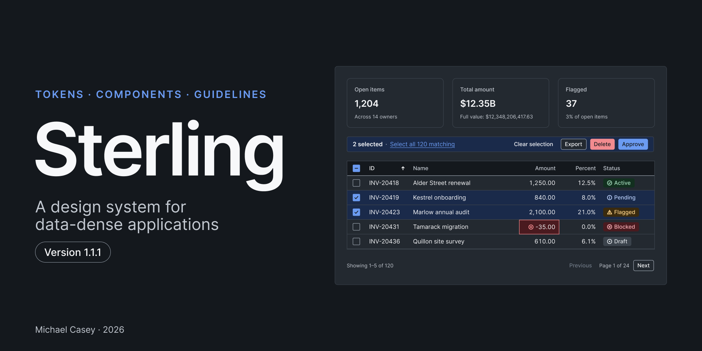
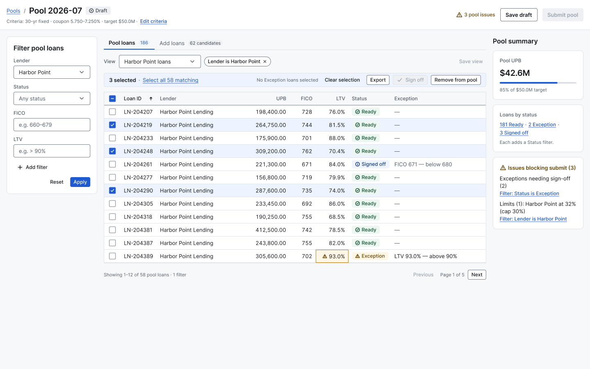

# Sterling Design System

Sterling is a design system for data-dense applications: tokens, a Figma component library, the same
components in code, and written guidelines. It gives first-class support to the things dense screens
depend on, such as grids, filters, bulk actions, and numbers that always line up.



- **Figma file (view only):** [Sterling Design System](https://www.figma.com/design/1Ah1TdgOoCkaCq1dUZFYbd/Sterling-Design-System)
- **Storybook (coded components):** [mcasey10.github.io/sterling-design-system/storybook](https://mcasey10.github.io/sterling-design-system/storybook/)
- **Token reference site:** [mcasey10.github.io/sterling-design-system](https://mcasey10.github.io/sterling-design-system/)
- **Version:** see the [latest release](https://github.com/mcasey10/sterling-design-system/releases/latest) and the [changelog](CHANGELOG.md)

## What's in it

| | |
|---|---|
| **Tokens** | One source file, [`tokens/tokens.json`](tokens/tokens.json). Color has Light and Dark modes; Density has Compact, Default, and Comfortable. Semantic tokens alias a hidden set of primitives, and every published variable says what it's for. |
| **Components** | 44 published components: buttons, inputs and menus, chips, tabs, a dialog, summary metrics, 20 icons, and a data grid built from cells, rows, headers, pagination, and loading and empty states. Every interactive control has a visible keyboard focus state, plus the states it needs: hover, pressed, disabled, selected, error. |
| **Coded components** | The same components in React, documented in Storybook: all 24 components and the icons, with a Docs page each and a toolbar that switches Light and Dark and the three densities. See [below](#coded-components). |
| **Guidelines** | The rules the components follow: accessibility, data display, naming, states, color, and icons, with do and don't pairs. Each component has its own entry saying when to use it and when not to. |
| **Patterns** | Nine compositions with neutral sample data: filters with a grid and bulk actions, the bulk action bar's states, filter panel and chips, saved views, status chips, warning and exception cells, the confirmation dialog, form layout, and loading, empty, and error states. |
| **Template** | A blank 1440 × 900 screen on a 12-column grid to duplicate and build on. |
| **An example** | A loan pooling workflow built with Sterling, on its own page. See [below](#the-example-loan-pooling). |

## How it's built

**The Figma file is generated.** A local Figma plugin reads the token file and builds everything:
variables, text styles, components, and the documentation pages. To change Sterling, I change the
tokens or the plugin code and rebuild. Nothing is drawn by hand, so the file can't drift from its
source.

Rebuilding is safe. The plugin finds each component, variant, and layer by name and updates it in
place, so every instance in the file stays linked and keeps its overrides.

**Figma and code are built from the same sources.** One table lists every component's variants and
properties; another holds its documentation. The plugin draws the Figma components from them, and
the React components take their prop types and Storybook pages from them. A component can't gain a
variant in one place and not the other without a check failing.

**Each build checks itself.** It reports a problem, and says where, if:

- a text and background pair falls below WCAG contrast (248 pairs, in Light and Dark);
- a published component is missing its description or its documentation link, or a published
  variable is missing its description;
- an instance loses the link to its main component;
- a right-aligned header isn't flush with the numbers below it, a value doesn't fit its column, or
  a grid shows more than one sort icon;
- a link isn't underlined, in a component or in any instance of it;
- in the example, the totals don't add up, an action has no visible trigger, or a developer
  annotation has lost its target;
- a Figma component has no coded counterpart, or a coded component's props don't match its definition;
- any story fails an automated accessibility check, in Light or Dark;
- the coded components' CSS uses a color, size, or font value that isn't a token.

**I built Sterling with [Claude Code](https://claude.com/claude-code), under my direction.** I set
the scope, made the design decisions, and reviewed each step in Figma and in the browser before
accepting it. Claude Code wrote the plugin, the components, and the scripts, and ran the checks.
[ARCHITECTURE.md](ARCHITECTURE.md) explains how the pieces fit together, in plain language.

## Coded components

[Storybook](https://mcasey10.github.io/sterling-design-system/storybook/) has every component as a
React component, styled only with Sterling's tokens.

- **A Docs page per component** with the same guidance as the Figma library, its props, and an
  "All variants" story laid out like its Figma variant set.
- **Theme and Density in the toolbar**, so any story can be seen in Light or Dark and at Compact,
  Default, or Comfortable.
- **Built for the keyboard and screen readers.** The data grid is a real table: Tab moves between
  the sort buttons and the row checkboxes, Shift selects a range, and the selection count is
  announced. The select and the dialog follow the standard keyboard patterns.
- **Where Figma and code differ, it's written down.** Code has no "state" property, for example:
  hover and focus come from the browser. [ARCHITECTURE.md](ARCHITECTURE.md#11-where-figma-and-code-differ)
  lists each difference and the reason for it.

## The example: loan pooling

The last page of the Figma file is an example built with Sterling: a screen where a trader
assembles mortgage loans into a pool, resolves the loans that fall outside the eligibility rules,
and submits it.



- Two screens (Pool loans and Add loans), the states of the bulk action bar, and the dialogs.
- An About frame with the business context, the workflows, and the eligibility rules, written for
  readers who don't know the mortgage industry.
- Developer annotations on the Pool loans screen (press Shift+Y in Figma to show or hide them).
- Every number on the page comes from one data file, and each loan's status is worked out from its
  figures, so the screens and the documentation can't disagree.

All data is fictional: the lenders, loans, and figures are made up.

## Run it yourself

You need [Node.js](https://nodejs.org) 20.19 or newer.

### Storybook

```bash
cd ui
npm install
npm run storybook
```

Storybook opens at http://localhost:6006.

### The Figma library

You also need the Figma desktop app on a plan that allows several variable modes per collection
(Professional or higher).

```bash
cd plugin
npm install
npm run build
```

Then, in an empty Figma design file:

1. Choose **Plugins → Development → Import plugin from manifest…** and select `plugin/manifest.json`.
2. Run **Plugins → Development → Sterling → Build library**.
3. Run **Plugins → Development → Sterling → Build example**.
4. One manual step, once per file: turn on tabular figures for the **Numeric** text style
   (**Type settings → Details → Numbers → Style → Monospace uppercase/lining**). The plugin can't
   set it, and reminds you until it's on.

### The checks and the site

From the repo root. The token checks need nothing installed; the others need `npm install` in `ui/`.

```bash
npm run contrast
```

```bash
npm run check:tokens
```

```bash
npm run check:parity
```

```bash
npm run check:css
```

```bash
npm run check:a11y
```

`check:a11y` builds Storybook and runs it in Chrome. To build the whole site (the token reference
with Storybook beside it) and look at it locally:

```bash
npm run site
```

```bash
npm run site:serve
```

## Find your way around

| | |
|---|---|
| [ARCHITECTURE.md](ARCHITECTURE.md) | How it fits together: folders, the build cycle, what you can edit in Figma, how the checks work, and where Figma and code differ |
| [docs/reference.md](docs/reference.md) | Every collection, component, and property, and each tool's options |
| [CONTRIBUTING.md](CONTRIBUTING.md) | How a change is proposed, built, checked, and released |
| [CHANGELOG.md](CHANGELOG.md) | What changed in each version |
| [docs/manual-walkthrough.md](docs/manual-walkthrough.md) | How a designer would build these variables and variants by hand |

## License

The code (the plugin, the components, the scripts, and the token file) is under the
[MIT License](LICENSE). The documentation and the design content are under [CC BY 4.0](LICENSE-docs.md).

© 2026 Michael Casey
