# Sterling Design System

A design system for data-dense applications: tokens, a Figma library, and the same components in React, all
from one set of definitions: a plugin builds the Figma library, the React components follow the same definitions,
and a check fails if a component's variants or properties ever differ between Figma and code.

**Website: [mcasey10.github.io/sterling-design-system](https://mcasey10.github.io/sterling-design-system/)**,
with every way in, for each kind of reader. Find the row that matches what you want to do with Sterling, then
follow its links.

<!-- generated: start-here (npm run docs:sync, from definitions/audiences.ts) -->
| Who you are | Where to go |
|---|---|
| **Evaluator**<br>You want to see what Sterling covers and how it's built, without setting anything up. | [Try the live example](https://mcasey10.github.io/sterling-design-system/example/) · *Browser*<br>A working screen built from Sterling's components<br><br>[Token reference](https://mcasey10.github.io/sterling-design-system/tokens/) and [Storybook](https://mcasey10.github.io/sterling-design-system/storybook/) · *Browser*<br>Tokens, components, guidance<br><br>[Figma Community preview](https://www.figma.com/community/file/1691833753587232312) · *Browser*<br>The Figma library |
| **Product designer**<br>You design screens in Figma. Start from components, variables and guidance that match the code, so what you hand off is what gets built. | [Figma library on Figma Community](https://www.figma.com/community/file/1691833753587232312) · *Duplicate*<br>Variables, components, guideline and pattern pages |
| **Developer**<br>You build screens in React. Use the same components and tokens as the designs, with props named after the Figma properties. | [sterling-ui from the GitHub Release](https://mcasey10.github.io/sterling-design-system/install/) · *Install*<br>Components and token CSS<br><br>[Storybook Docs](https://mcasey10.github.io/sterling-design-system/storybook/) · *Browser*<br>Guidance for each component |
| **AI-assisted developer**<br>You build with an AI coding tool. Give it Sterling's components, tokens and rules, so the code it writes follows the system instead of inventing its own. | [Watch the demo](https://mcasey10.github.io/sterling-design-system/demo/) · *Browser*<br>An AI tool building a screen with Sterling<br><br>[sterling-ui from the GitHub Release](https://mcasey10.github.io/sterling-design-system/install/) · *Install*<br>Components and token CSS<br><br>[MCP server from the GitHub Release](https://mcasey10.github.io/sterling-design-system/ai-tools/#set-up) · *Download and register once*<br>Guidance and token lookup for your AI tool<br><br>Or [llms.txt](https://mcasey10.github.io/sterling-design-system/llms.txt) and [the AI files](https://mcasey10.github.io/sterling-design-system/ai/index.json) · *Read by URL*<br>The same information, for tools that read web pages |
| **Design system owner**<br>You change Sterling itself. Edit the source, and every output is regenerated and checked. | [GitHub repository](https://github.com/mcasey10/sterling-design-system) · *Clone*<br>The source everything above is generated from |

**Nothing to set up.** *Browser*: Open it in a web browser. *Duplicate*: Open the Community page and choose Open in Figma. You need a Figma account. *Read by URL*: Give your AI tool the address.

**Setup needed, once.** *Install*: Install the package into a React project: see Install sterling-ui. *Download and register once*: Download one file and register it with your AI tool: see Set up the MCP server. *Clone*: Clone the repository: see its CONTRIBUTING file.

**Set up:** [Install sterling-ui](https://mcasey10.github.io/sterling-design-system/install/) to add the components to a React project · [Set up the MCP server](https://mcasey10.github.io/sterling-design-system/ai-tools/#set-up) to connect Sterling to your AI tool.
<!-- /generated: start-here -->


I built Sterling with [Claude Code](https://claude.com/claude-code), under my direction: I set the scope, made
the design decisions, and reviewed each step in Figma and in the browser. Claude Code wrote the plugin, the
components, and the scripts, and ran the checks.

## What's in it

| | |
|---|---|
| **Tokens** | One source file, [`tokens/tokens.json`](tokens/tokens.json). Color has Light and Dark modes; Density has Compact, Default, and Comfortable. Semantic tokens alias a hidden set of primitives, and every published variable says what it's for. The [token reference](https://mcasey10.github.io/sterling-design-system/tokens/) shows every value and contrast pair. |
| **Components** | 24 components and 20 icons: buttons, inputs and menus, chips, tabs, a dialog, summary metrics, and a data grid built from cells, rows, headers, pagination, and loading and empty states. Every interactive control has a visible keyboard focus state, plus the states it needs: hover, pressed, disabled, selected, error. |
| **Coded components** | The same components in React, as the `sterling-ui` package, documented in Storybook: the same 24 components and 20 icons, with a Docs page each and a toolbar that switches Light and Dark and the three densities. See [below](#coded-components). |
| **For AI tools** | An MCP server, `llms.txt`, and machine-readable files that describe every component, token, and guideline, so an AI tool builds with Sterling instead of inventing its own. See [below](#with-ai-tools). |
| **Guidelines** | The rules the components follow: accessibility, data display, naming, states, color, and icons, with do and don't pairs. Each component has its own entry saying when to use it and when not to. |
| **Patterns** | Nine compositions with neutral sample data: filters with a grid and bulk actions, the bulk action bar's states, filter panel and chips, saved views, status chips, warning and exception cells, the confirmation dialog, form layout, and loading, empty, and error states. |
| **Template** | A blank 1440 × 900 screen on a 12-column grid to duplicate and build on. |
| **An example** | A loan pooling workflow built with Sterling, on its own page. See [below](#the-example-loan-pooling). |

## How it's built

**The Figma file is generated.** A local Figma plugin reads the token file and builds everything:
variables, text styles, components, and the documentation pages. To change Sterling, I change the
tokens or the plugin code and rebuild. Nothing is drawn by hand, so the file can't drift from its
source.

Rebuilding is safe. The plugin finds each component, variant, and layer by name and updates it in
place, so every instance in the file stays linked and keeps its overrides.

**Figma, code, and the AI files are built from the same sources.** One table lists every component's
variants and properties; another holds its documentation. The plugin draws the Figma components from them,
the React components take their prop types and Storybook pages from them, and the files for AI tools are
generated from them. A component can't gain a variant in one place and not the others without a check failing.

**Each build checks itself.** It reports a problem, and says where, if:

- a text and background pair falls below WCAG contrast (124 pairs, each in Light and Dark);
- a published component is missing its description or its documentation link, or a published
  variable is missing its description;
- an instance loses the link to its main component;
- a right-aligned header isn't flush with the numbers below it, a value doesn't fit its column, or
  a grid shows more than one sort icon;
- a link isn't underlined, in a component or in any instance of it;
- in the example, the totals don't add up, an action has no visible trigger, or a developer
  annotation has lost its target;
- a Figma component has no coded counterpart, or a coded component's props don't match its definition;
- any story or website page fails an automated accessibility check, in Light or Dark;
- the coded components' CSS uses a color, size, or font value that isn't a token;
- the files for AI tools no longer match their sources, or the MCP server's copy of them is out of date.

[ARCHITECTURE.md](ARCHITECTURE.md) explains how the pieces fit together, in plain language.

## Coded components

[Storybook](https://mcasey10.github.io/sterling-design-system/storybook/) has every component as a
React component, styled only with Sterling's tokens. To use them in your app,
[install sterling-ui](https://mcasey10.github.io/sterling-design-system/install/) from the GitHub Release.

- **A Docs page per component** with the same guidance as the Figma library, its props, and an
  "All variants" story laid out like its Figma variant set.
- **Theme and Density in the toolbar**, so any story can be seen in Light or Dark and at Compact,
  Default, or Comfortable.
- **Built for the keyboard and screen readers.** The data grid is a real table: Tab moves between
  the sort buttons and the row checkboxes, Shift selects a range, and the selection count is
  announced. The select and the dialog follow the standard keyboard patterns.
- **Where Figma and code differ, it's written down.** Code has no "state" property, for example:
  hover and focus come from the browser. [ARCHITECTURE.md](ARCHITECTURE.md#11-where-figma-and-code-differ)
  lists each difference and the reason for it.

## With AI tools

An AI tool builds better screens with Sterling when it can look things up: which components exist, what each
is for, which token to use, and the rules that apply. Sterling publishes that in two ways, from the same files:

- **An MCP server.** One file, `sterling-mcp.js`, on the GitHub Release: register it with any MCP client, once.
  [Set it up](https://mcasey10.github.io/sterling-design-system/ai-tools/#set-up), or see
  [mcp/README.md](mcp/README.md) for its tools.
- **Files read by URL.** [llms.txt](https://mcasey10.github.io/sterling-design-system/llms.txt) describes
  Sterling and links to the [AI files](ai/) (components, tokens, guidelines), for any tool that can fetch a web page.

<picture>
  <source media="(prefers-color-scheme: dark)" srcset="docs/diagrams/ai-layer.dark.svg">
  
</picture>

[Sterling and AI tools](https://mcasey10.github.io/sterling-design-system/ai-tools/) follows one component,
Chip/Status, from its sources to code an AI tool wrote.

## The example: loan pooling

The last page of the Figma file is an example built with Sterling: a screen where a trader
assembles mortgage loans into a pool, resolves the loans that fall outside the eligibility rules,
and submits it.


- Two screens (Pool loans and Add loans), the states of the bulk action bar, and the dialogs.
- An About frame with the business context, the workflows, and the eligibility rules, written for
  readers who don't know the mortgage industry.
- Developer annotations on the Pool loans screen (press Shift+Y in Figma to show or hide them).
- Every number on the page comes from one data file, and each loan's status is worked out from its
  figures, so the screens and the documentation can't disagree.

The same screen was first built in code by an AI session whose only sources for Sterling were the `sterling-ui`
package and the MCP server, then corrected in follow-up commits: see Examples › Pool loans in
[Storybook](https://mcasey10.github.io/sterling-design-system/storybook/).

All data is fictional: the lenders, loans, and figures are made up.

## Work on Sterling

For the design system owner (maintainers): changing Sterling itself means cloning this repository. Every output
(the Figma library, the components, the AI files, the website) is regenerated from it and checked.
[CONTRIBUTING.md](CONTRIBUTING.md) has every step, from proposing a change to releasing it.

**Where:** any terminal: PowerShell on Windows, Terminal on macOS, or the terminal in your editor. No
administrator rights needed. Run the commands from the repository's folder.

**You need:** Node.js 20.19 or later. Check: `node --version` shows `v20.19` or higher. If not, install the LTS
version from [nodejs.org](https://nodejs.org), then open a new terminal. For the Figma library, also the Figma
desktop app on a plan that allows several variable modes per collection (Professional or higher).

### Storybook

```bash
npm install --prefix ui
```

```bash
npm run storybook
```

It worked if Storybook opens at http://localhost:6006.

### The Figma library

```bash
npm install --prefix plugin
```

```bash
npm run build --prefix plugin
```

Then, in an empty Figma design file:

1. Choose **Plugins → Development → Import plugin from manifest…** and select `plugin/manifest.json`.
2. Run **Plugins → Development → Sterling → Build library**.
3. Run **Plugins → Development → Sterling → Build example**.
4. One manual step, once per file, to turn on tabular figures: edit the **Numeric** text style, open
   **Type details (…) → Details → Numbers**, and set **Style** to **Monospace uppercase/lining**. The
   plugin can't set it, and reminds you until it's on.

It worked if each command's notification ends with its checks passing.

### The website and the checks

The website (Start here, the token reference, the AI page, Storybook, and the AI files) builds into `site/`.
It also needs the MCP server's dependencies, once (Storybook's are installed above):

```bash
npm install --prefix mcp
```

```bash
npm run site
```

```bash
npm run site:serve
```

It worked if the site opens at http://localhost:6008. [CONTRIBUTING.md](CONTRIBUTING.md#3-check) lists every
check and what it covers.

## Find your way around

| | |
|---|---|
| [ARCHITECTURE.md](ARCHITECTURE.md) | How it fits together: folders, the build cycle, what you can edit in Figma, how the checks work, where Figma and code differ, and the files for AI tools |
| [docs/reference.md](docs/reference.md) | Every collection, component, and property, and each tool's options |
| [mcp/README.md](mcp/README.md) | The MCP server: setting it up, and its tools |
| [CONTRIBUTING.md](CONTRIBUTING.md) | How a change is proposed, built, checked, and released |
| [CHANGELOG.md](CHANGELOG.md) | What changed in each version |
| [docs/manual-walkthrough.md](docs/manual-walkthrough.md) | How a designer would build these variables and variants by hand |

## License

The code (the plugin, the components, the scripts, and the token file) is under the
[MIT License](LICENSE). The documentation and the design content are under [CC BY 4.0](LICENSE-docs.md).

© 2026 Michael Casey
