# Example: loan pooling — planning diagrams

Planning diagrams for the **Example: Loan pooling** page in the generated Figma file:
build **Pool 2026-07** toward a $50.0M target from candidate loans, resolve issues, and
submit the pool. All data is hypothetical.

The brief, eligibility rules, filter model and screen steps live in Figma, in that page's
**About this example** frame (generated from `plugin/src/example/`, the same data the
screens use), so they're not repeated here.

## Pool workflow

Draft → Submit pool → Submitted. Submit pool is enabled only when the pool has 0 issues;
submitted pools are read-only.

Source: [`pool-workflow.mmd`](pool-workflow.mmd)

## Loan workflow (inside a Draft pool)

Available → Add to pool → Ready (eligible) or Exception (needs sign-off); Exception →
Sign off → Signed off; Remove from pool returns any loan to Available; Ineligible loans
can't be added. Loans have no submitted state of their own; they lock with the pool.

Source: [`loan-workflow.mmd`](loan-workflow.mmd)

## Where it lives

| What | Where |
|---|---|
| Screens (Pool loans, Add loans), Example states, About frame, example components | Figma → **Example: Loan pooling** page |
| Plugin code | `plugin/src/example/loanPooling.ts`; sample data, rules, counts and the consistency check in `loanData.ts` |
| Diagrams | This folder (`.mmd` source, `.svg` rendered; re-render command in the repo README) |
